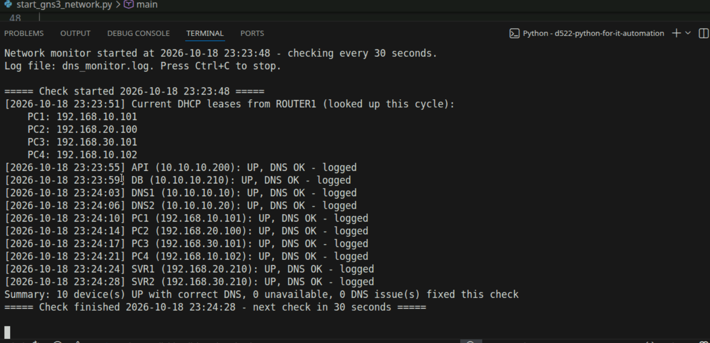
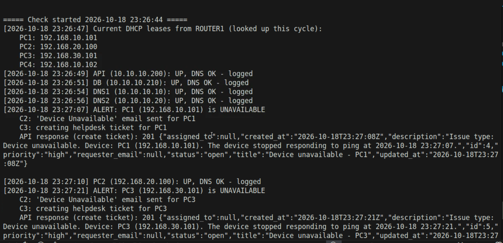
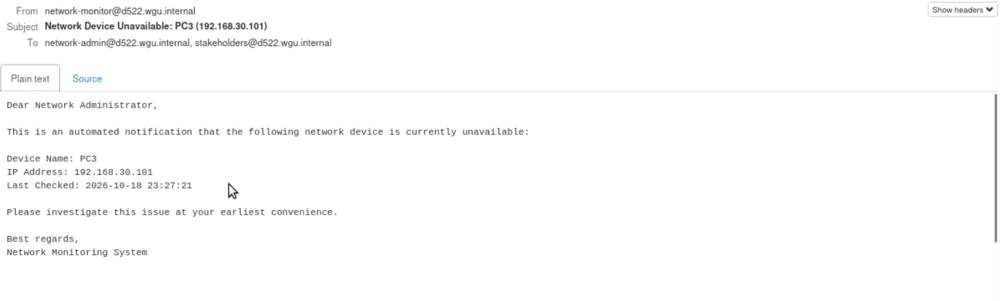
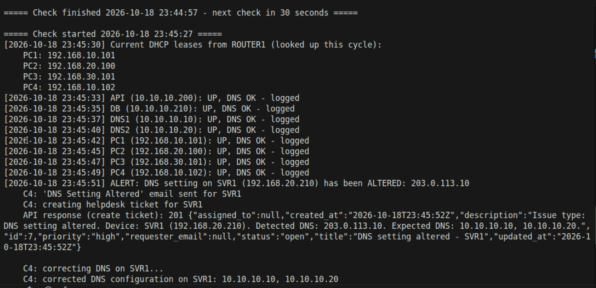
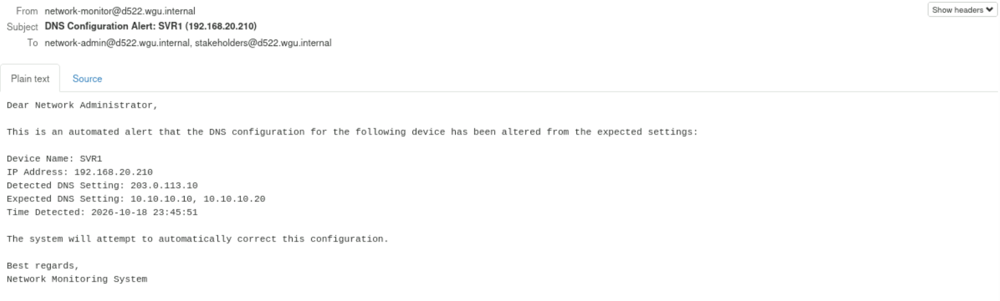
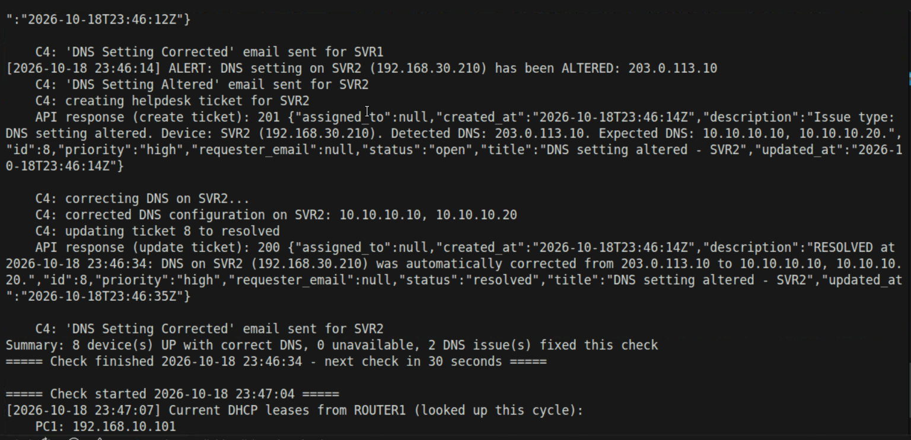
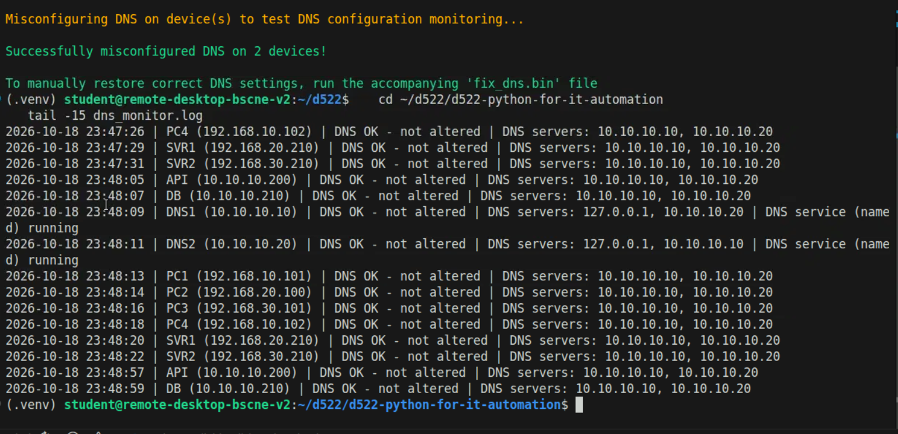

# DNS Incident Response & Continuous Monitoring Automation

Python automation that responds to a DNS compromise on an enterprise network, then keeps the network protected with a monitor that detects and fixes the same problems automatically.

Built and tested in a 16-device GNS3 lab network (Ubuntu servers and PCs, a VyOS router/firewall, Open vSwitch switches, BIND9 DNS, a helpdesk ticketing API and an SMTP server).

> **Context:** this was the final course of my B.S. in Information Technology at WGU (D522, Python for IT Automation). The network, devices and email addresses belong to the course lab environment.

## The scenario

Several devices were reconfigured to use a rogue DNS server, and one of the internal DNS servers went down. The project has two phases:

1. **Incident response.** Find the compromised devices, alert stakeholders, open tickets, restore the DNS service, fix every affected device, and send a resolution notice.
2. **Continuous monitoring.** Run a monitor that checks every device on a schedule. If a device goes offline or its DNS settings are altered again, the monitor alerts, opens a ticket and remediates automatically.

## What it does

### Phase 1: Incident response (`incident-response/`)

| Script | What it does |
|---|---|
| `dns_service.py` | Connects to both DNS servers over SSH, finds which one has its DNS service (BIND9 `named`) stopped, restarts it and confirms it is running. |
| `dns_incident.py` | Reads the device inventory, pings every device, and inspects each device's DNS settings. Flags any device using a non-internal DNS server, emails an incident alert, creates a helpdesk ticket per compromised device, corrects each device's DNS, and emails a resolution notice listing every fixed device. |

### Phase 2: Continuous monitoring (`continuous-monitoring/`)

| Script | What it does |
|---|---|
| `backup_dns_config.py` | Before any changes, backs up both DNS servers' BIND configuration and zone records to `DNS-Backup/Server-1` and `DNS-Backup/Server-2`. |
| `network_monitor.py` | Runs continuously (every 30 seconds). Each cycle it: |

1. Pulls the **current DHCP leases from the router**, so DHCP-assigned PCs are always found at their current IP. Nothing is hardcoded.
2. **Pings every device.** If one stops responding, it emails a "Device Unavailable" notice and opens a helpdesk ticket, once per outage, and reports when the device comes back.
3. **Checks every device's DNS settings.** If they've been altered, it emails an alert, opens a ticket, corrects the settings, verifies the fix, marks the ticket resolved, and sends a "DNS Corrected" notice.
4. **Checks the DNS service itself** on both DNS servers and restarts it if it has stopped.
5. **Logs** a timestamped entry for every device whose DNS is correct and unaltered.

## How it works

- **SSH automation with Paramiko.** Every device is managed by running commands over SSH.
- **Firewall-aware connections.** The lab's zone-based firewall only allows return traffic into the user VLANs, so when a direct connection is blocked the scripts tunnel SSH through the router.
- **Dynamic DHCP discovery.** IPs for DHCP clients come from the VyOS router's lease table (`show dhcp server leases`) at runtime.
- **systemd-resolved awareness.** When a device's `/etc/resolv.conf` only points at the local stub resolver (`127.0.0.53`), the scripts query `resolvectl` for the real upstream DNS servers, and fix them through `resolved.conf` and `resolvectl`.
- **Helpdesk API integration.** Tickets are created (`POST`) and resolved (`PATCH`) through a REST API with Bearer-token authentication.
- **Email notifications** through SMTP, following set templates for each event.

## Screenshots

| | |
|---|---|
| DHCP leases looked up from the router every cycle |  |
| Offline device detected, ticket created |  |
| "Device Unavailable" email |  |
| Altered DNS detected and ticket opened |  |
| "DNS Configuration Alert" email |  |
| DNS corrected and ticket resolved |  |
| Monitoring log |  |

## Tech used

Python · Paramiko (SSH) · Requests (REST API) · smtplib · BIND9 · VyOS · systemd-resolved · GNS3 · Linux (Ubuntu) · Git/GitLab

## Running it

```bash
python3 -m venv .venv
source .venv/bin/activate
pip install -r requirements.txt
export HELPDESK_API_TOKEN="your-token-here"

# Phase 1
cd incident-response
python dns_service.py
python dns_incident.py

# Phase 2
cd ../continuous-monitoring
python backup_dns_config.py
python network_monitor.py      # Ctrl+C to stop
```

The device list comes from `network_devices.csv`. IP addresses and server addresses are specific to the lab environment. **Device passwords have been replaced with `CHANGE_ME`** in this repository: fill them in for your own environment, and keep real credentials out of version control. The helpdesk API token is read from the `HELPDESK_API_TOKEN` environment variable, never stored in the code.
